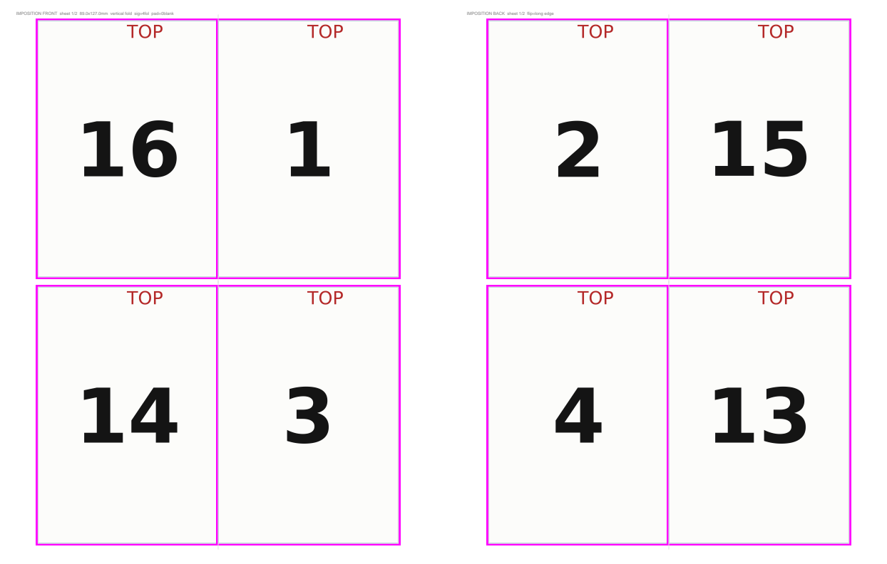

# impose

**Print-ready booklet imposition for hand bookbinders — free, scriptable, and size-agnostic.**

Imposition is the step between "I have a PDF of my book" and "I have printed sheets I can fold and sew." Each page has to land in the right spot, in the right orientation, so that after duplex printing, cutting, and folding, the pages come out in order. The tools that do this well are mostly expensive prepress software; the free ones tend to handle only one fold layout or none of the fine-tuning a hand-printed book needs.

`impose` takes any PDF and produces a print-ready imposed PDF: front and back sheets, nested saddle signatures, bleed, cut lines, and fold marks. It works for anything from a 30 × 40 mm miniature to a full-size book.


*Demo output: 16-page signature, 3.5 × 5 in pages on US Letter. The magenta band is bleed that gets trimmed away; page 2 prints behind page 1 after a long-edge flip.*

## Features

- **Any page size, any sheet size.** Letter, A4, tabloid, 13 × 19 — the tool calculates how many folios fit per side and centers the grid.
- **Nested saddle signatures** of any thickness (2 folios = 8 pages, 4 = 16 pages, and so on). Page counts that don't fill the last signature are padded with blank leaves automatically.
- **Duplex alignment correction.** Most desktop printers shift the back side slightly. Measure the drift once, enter it, and fronts and backs line up through the paper.
- **Bleed and cut marks** (full perimeter, perimeter with corner gaps, or corner crosses), plus fold ticks.
- **Facsimile tools** for printing scanned manuscripts: per-side cropping, automatic removal of black digitization borders, and paper-color correction for yellowed pages.
- **Batch mode** with settings encoded in filenames, so each book in a folder can use different options.
- **Memory-safe on large books.** Prepared pages are cached to disk, so a 300-page color facsimile won't run out of RAM, and an interrupted run resumes where it stopped.

## Install

Requires Python 3.9+.

```bash
pip install pillow numpy reportlab pypdfium2
```

## Quick start

See what it does with no input file — this generates numbered test pages and imposes them:

```bash
python impose.py --demo 16 --out demo.pdf
```

Print `demo.pdf` double-sided (flip on long edge), cut along the lines, fold, and nest the folios. The pages should read 1–16 in order. This is also the fastest way to check your printer's duplex alignment before printing a real book.

## Usage

### One PDF

```bash
python impose.py --pdf mybook.pdf --out mybook_imposed.pdf
```

Common options:

| Option | What it does | Example |
|---|---|---|
| `--page WxH` | Finished page size in mm | `--page 95x140` |
| `--sheet WxH` | Paper size in mm | `--sheet 210x297` (A4) |
| `--folios N` | Folios per signature (4 pages each) | `--folios 2` |
| `--bleed N` | Bleed in mm | `--bleed 2` |
| `--marks` | `perimeter`, `perimeter_gap`, or `crosses` | `--marks crosses` |
| `--fit` | `fit` (letterbox), `fill` (cover), or `autotrim` | `--fit fill` |
| `--render` | Rasterize whole pages instead of extracting the main image | |
| `--mirror` | Swap page sides within each folio | |
| `--gray` | Grayscale output | |

### Plan before printing

Report how many sheets a book needs, and warn when the last sheet would be mostly empty:

```bash
python impose.py --check 40
```

### Batch mode

Run with no arguments and it imposes every PDF in `process_pdfs/`, writing results to `output/`. Settings go in the filename, separated by double underscores:

```
journal__page-95x140__folios-2.pdf
herbal__render__page-30x40__sheet-330x483__marks-perimeter_gap.pdf
codex__page-30x40__paper-auto__paperstr-0.7.pdf
```

Run `python impose.py` with an empty folder to print the full list of filename flags.

### Default layout

All defaults live in the `CFG` block at the top of `impose.py`. Out of the box: 3.5 × 5 in (89 × 127 mm) pages, 16-page signatures, US Letter sheets, 1 mm bleed.

## Printing scanned manuscripts

The facsimile options came from printing miniature reproductions of historical manuscripts:

- **Black border removal:** `--cropL page --cropR page --cropT page --cropB page` finds the paper edge in each scan and crops the digitization matte away, so the page sits centered in the trim.
- **Yellowed paper:** `--paper auto --paper-strength 0.7` samples the paper color and shifts it toward white while keeping ink dark. Use `--paper-target F2E8DB` to keep a warm cream tone instead of pure white.
- **Line art:** `--gray --lineart` boosts contrast and thickens fine lines that would otherwise disappear at small sizes.

## Correcting duplex drift

1. Print the demo double-sided.
2. Fold one folio along its fold tick and hold it to the light.
3. Measure how far the back cut line sits from the front one.
4. Set `duplex_offset_x_mm` (and `duplex_offset_y_mm` if needed) in `CFG`, or add `dxoff-0.5` to a batch filename.

Positive values mean the back prints to the right of the front, which is the most common case.

## How it works

Pages are placed using standard nested-saddle math. For a signature of F folios, folio *i* (0 = outermost) carries:

| Front left | Front right | Back left | Back right |
|---|---|---|---|
| 4F − 2i | 1 + 2i | 2 + 2i | 4F − 1 − 2i |

offset by the signature's starting page. Each source page then goes through crop → paper correction → fit → bleed before being drawn into its slot. Back sheets are mirrored to match the printer's flip edge.

See [PROCESS.md](PROCESS.md) for the design decisions and problems solved along the way.

## License

MIT. See [LICENSE](LICENSE).
